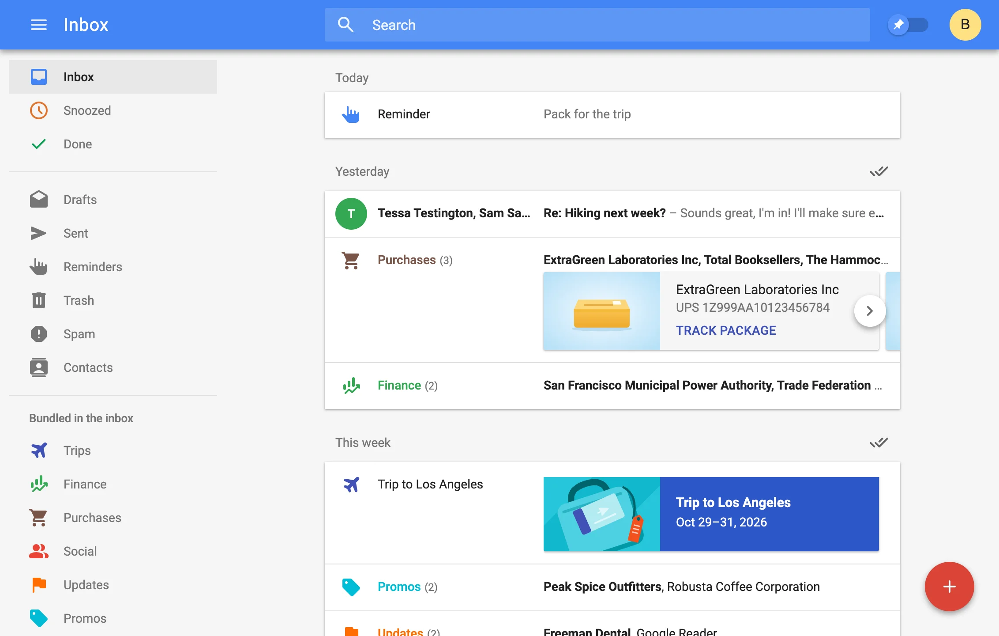

# NeoInbox

Recreating the classic Google™ Inbox experience as a fully local Thunderbird extension that works with any email account.

Website: [neoinbox.freakified.net](https://neoinbox.freakified.net)

Install: [addons.thunderbird.net](https://addons.thunderbird.net/en-US/thunderbird/addon/neoinbox/)



NeoInbox works with any email account, runs completely locally, and includes
all your favorite classic Google Inbox features like a unified mail stream,
bundling, trip detection, reminders, and more!

## Building

```sh
pnpm install
pnpm package   # builds neoinbox.xpi
pnpm dev       # rebuilds dist/ on change; load dist/manifest.json as a temporary add-on
pnpm harness   # runs the UI in a browser on a fake mailbox
pnpm test      # runs the automated tests! you love test-driven development don't you?
```

### Building from source (for add-on reviewers)

Built on macOS 27 with Node 26.8.2 and pnpm 12.4.2; any OS with those versions
should give the same output.

1. Install Node 26.8.2 from <https://nodejs.org> (or with a version manager such as `nvm install 26.8.2`).
2. Enable pnpm at the version pinned in `package.json`: `corepack enable`
3. From the source root:

   ```sh
   pnpm install --frozen-lockfile
   pnpm package
   ```

The add-on's files are in `dist/`, zipped as `neoinbox.xpi`. They are built from
`inbox.html`, `src/` and `public/` (see `vite.config.ts`) plus the npm packages in
`pnpm-lock.yaml`. `site/` (the project website), `scripts/`, `dev.html`
and `src/eval/` are not part of the add-on.

`pnpm source-zip` packages the committed source as `neoinbox-source.zip`.

NeoInbox is an independent project and is not affiliated with, endorsed by, or sponsored by Google. Google and Gmail are trademarks of Google LLC.

## License

[MPL-2.0](LICENSE)
