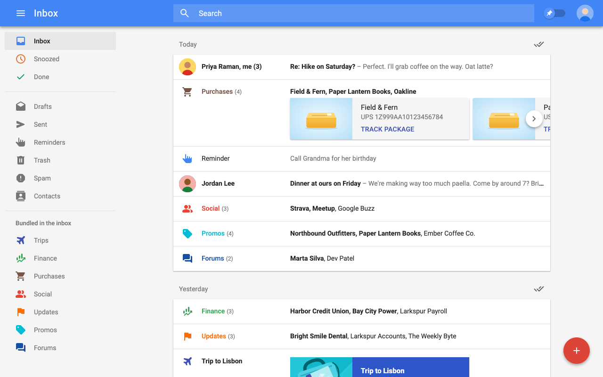

# NeoInbox

An open-source re-creation of Google Inbox as a Thunderbird MailExtension.



NeoInbox works with any email account, runs completely locally, and includes
all your favorite classic Google Inbox features like a unified mail stream,
bundling, trip detection, reminders, and more!

## Building

```sh
pnpm install
pnpm package   # builds neoinbox.xpi
pnpm dev       # rebuilds dist/ on change; load dist/manifest.json as a temporary add-on
pnpm harness   # runs the UI in a browser on a fake mailbox
pnpm test      # runs the automated tests! you love test-driven development don't you?
```

NeoInbox is an independent project and is not affiliated with, endorsed by, or sponsored by Google. Google and Gmail are trademarks of Google LLC.

## License

[MPL-2.0](LICENSE)
